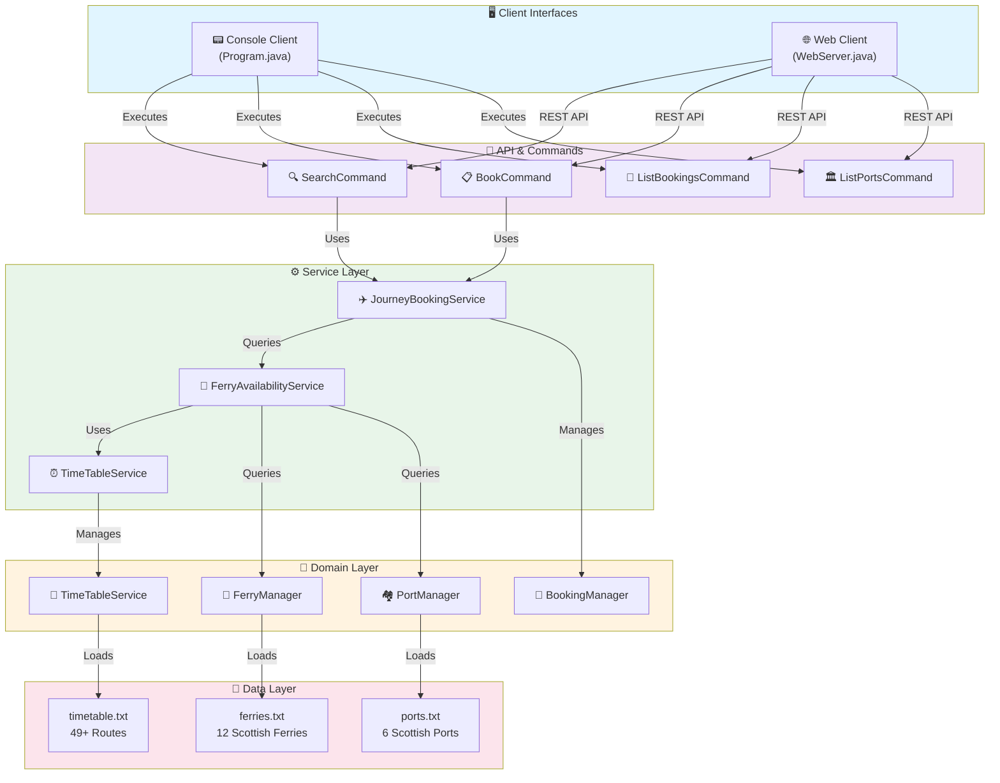
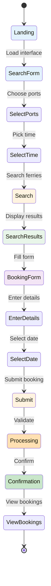
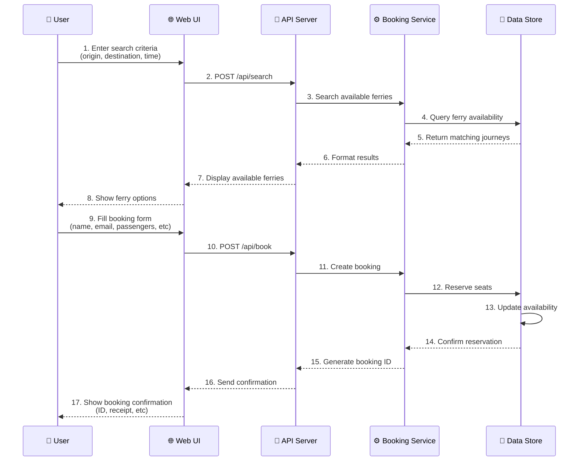

# Legacy Ferry Booking System - Enhanced Edition

A comprehensive ferry booking application built in Java that provides both console-based and web-based interfaces for managing ferry reservations, schedules, and port information. **Now featuring enhanced realistic Scottish ferry network data!**

## 🎯 **Recent Enhancements - October 2025**

This system has been significantly enhanced with **realistic Scottish ferry network data** to provide comprehensive frontend booking capabilities:

### � **Enhanced Data Features**
- **6 Realistic Scottish Ports** (expanded from 3): Port Ellen, Oban Bay, Mallaig Harbor, Tobermory Port, Craignure Ferry, Brodick Terminal
- **12 Scottish Ferries** with authentic names: MV Caledonian Isles, MV Isle of Arran, MV Hebridean Princess, etc.
- **49+ Ferry Routes** with realistic schedules and journey times (45-180 minutes)
- **Rich Port Information**: Location details, facility information, and port codes
- **Enhanced Ferry Specifications**: Types (Small/Medium/Large), passenger/vehicle capacity, speed ratings

### 🌐 **Frontend-Ready Capabilities**
- **Interactive Web Interface**: Full-featured booking system at `http://localhost:8080`
- **RESTful API Endpoints**: Complete API for frontend integration (`/api/ports`, `/api/search`, `/api/book`)
- **Real-time Availability**: Dynamic seat and vehicle space tracking
- **Comprehensive Journey Planning**: Multi-route options with detailed schedules
- **Enhanced Search**: Filter by origin, destination, time, and ferry type

## �📋 Project Overview

This application simulates a comprehensive Scottish ferry booking system with functionality for:
- **Ferry Schedule Management**: View enhanced timetables with realistic Scottish routes
- **Advanced Booking Management**: Create, view, and manage ferry reservations with real-time availability
- **Multi-Port Network**: Handle 6 Scottish ports with complete inter-island connectivity
- **Web API**: Full RESTful endpoints optimized for frontend development
- **Console Interface**: Enhanced command-line interface with realistic ferry data

## 🛠️ Technology Stack

| Component | Technology | Version |
|-----------|------------|---------|
| **Language** | Java | 8 (1.8) - **Required** |
| **Build Tool** | Gradle | 7.6 |
| **HTTP Server** | Java HttpServer | Built-in |
| **JSON Processing** | org.json | 20160212 |
| **File I/O** | Apache Commons IO | 2.4 |
| **Testing** | JUnit | 4.12 |

## 🏗️ Architecture & Workflow



## 🚀 Getting Started

### Prerequisites

- **Java 8 JDK** (Required - this project is specifically designed for Java 8)
- **Gradle 7.6** (or use the included Gradle wrapper)

### 📥 Java 8 JDK Installation

This project **requires Java 8 JDK**. If you don't have it installed, download from one of these sources:

#### **Recommended: Eclipse Adoptium (Temurin 8)**
- **Website**: https://adoptium.net/temurin/releases/
- **Select**: Version `8 - LTS`, OS `Windows`, Architecture `x64`, Package `JDK`
- **Download**: `OpenJDK8U-jdk_x64_windows_hotspot_<version>.msi`

#### **Alternative: Amazon Corretto 8**
- **Website**: https://aws.amazon.com/corretto/
- **Select**: `Amazon Corretto 8` → Windows x64 installer

### ⚙️ Setting up JAVA_HOME (Critical Step!)

After installing Java 8 JDK, you **must** set the JAVA_HOME environment variable:

#### **Windows PowerShell:**
```powershell
# Replace with your actual Java 8 installation path
$env:JAVA_HOME = "C:\Program Files\Java\jdk1.8.0_XXX"
# OR if installed via Eclipse Adoptium:
$env:JAVA_HOME = "C:\Program Files\JAVAVersions\Eclipse Adoptium\jdk-8.0.XXX-hotspot"

# Update PATH to include Java 8
$env:PATH = "$env:JAVA_HOME\bin;$env:PATH"

# Verify installation
java -version
javac -version
```

#### **Expected Output:**
```
openjdk version "1.8.0_XXX"
OpenJDK Runtime Environment (Temurin)(build 1.8.0_XXX-bXX)
OpenJDK 64-Bit Server VM (Temurin)(build 25.XXX-bXX, mixed mode)
```

#### **Windows Command Prompt:**
```cmd
set JAVA_HOME=C:\Program Files\Java\jdk1.8.0_XXX
set PATH=%JAVA_HOME%\bin;%PATH%
java -version
```

### 🔧 Installation & Setup

1. **Clone the repository**
   ```bash
   git clone https://github.com/brendacampbelldev/ferry-booking-app.git
   cd ferry-booking-app
   ```

2. **Verify Java 8 is active**
   ```bash
   java -version
   # Should show Java 1.8.0_XXX
   ```

3. **Build the project**
   ```bash
   ./gradlew build
   ```

> **⚠️ Important**: If you get compilation errors, ensure JAVA_HOME points to Java 8 JDK, not a newer version. This project uses Java 8 specific APIs and build configurations.

### 🐙 **GitHub Codespaces Setup** (Specific to Codespace Environment)

If you're working in a GitHub Codespace, additional steps are required due to how the codespace manages file permissions and Java versions:

#### **Step 1: Fix Gradlew Permissions** (Codespace-specific)
The Gradle wrapper script requires execute permissions in the codespace:
```bash
chmod +x ./gradlew
```

#### **Step 2: Ensure Java 8 is Active** (Codespace-specific)
GitHub Codespaces uses SDKMAN for Java version management and may have Java 11+ set as default. Switch to Java 8:

**Option A: Check and update SDKMAN (if available)**
```bash
sdk use java 8.0.462-open
```

**Option B: Verify Java 8 is installed and active**
```bash
java -version
# Should display: openjdk version "1.8.0_XXX"

# If Java 11+ appears, install Java 8:
sudo apt update && sudo apt install -y openjdk-8-jdk

# Then set it as default:
sudo update-alternatives --set java /usr/lib/jvm/java-8-openjdk-amd64/jre/bin/java
sudo update-alternatives --set javac /usr/lib/jvm/java-8-openjdk-amd64/bin/javac
```

#### **Step 3: Build and Run**
Once permissions are fixed and Java 8 is confirmed:
```bash
./gradlew build
./gradlew runWeb
```

> **💡 Note**: These codespace-specific steps (chmod and Java setup) are **only required when working in a GitHub Codespace**. Local development on Windows/Mac/Linux uses the standard setup shown above.

## 🎯 How to Execute

### Option 1: Console Application
Run the interactive console version:
```bash
./gradlew run
```

**Available Console Commands:**
- `search <departure_port> <destination_port>` - Search for available ferries
- `book <id>` - Book a ferry crossing by ID
- `list bookings` - View all current bookings
- `list ports` - Display all available ports
- `help` - Show available commands
- `quit` - Exit the application

### Option 2: Web Server (Enhanced)
Start the HTTP web server with enhanced Scottish ferry data:
```bash
./gradlew runWeb
```

The web server will start on `http://localhost:8080` with a **fully interactive ferry booking interface**!

**🌟 Enhanced Web Features:**
- **Interactive Search Form**: Find ferries by origin port, destination port, and departure time
- **Real-time Booking**: Book journeys with passenger counts and instant confirmation
- **Port Information Display**: View all 6 Scottish ports with detailed information
- **Booking Management**: Track and view current reservations
- **Responsive Design**: User-friendly interface with enhanced styling

### 📱 **User Journey - Web Interface**



**Available API Endpoints:**

| Method | Endpoint | Parameters | Description |
|--------|----------|------------|-------------|
| GET | `/` | - | Enhanced interactive ferry booking interface |
| GET | `/api/ports` | - | List all Scottish ports with locations and facilities |
| GET | `/api/search` | `origin`, `dest`, `time` | Search available ferries between ports |
| GET | `/api/book` | `journey`, `passengers` | Create a new booking with passenger count |
| GET | `/api/bookings` | - | View all current bookings |
| GET | `/api/help` | - | Display help information and commands |

**🎯 API Usage Examples:**
```bash
# Get all ports with enhanced information
curl "http://localhost:8080/api/ports"

# Search ferries from Port Ellen to Oban Bay at 8:00 AM
curl "http://localhost:8080/api/search?origin=1&dest=2&time=08:00"

# Book journey ID 10 for 4 passengers
curl "http://localhost:8080/api/book?journey=10&passengers=4"

# View all current bookings
curl "http://localhost:8080/api/bookings"
```

### 🔄 **Booking Workflow**



### Option 3: Test Runner
Run with predefined test data:
```bash
java -cp build/classes/main ferry.booking.TestRunner
```

## � Troubleshooting

### Common Issues & Solutions

#### **Build Fails with "cannot find symbol" or compatibility errors**
```bash
# Check your Java version
java -version

# Should output: openjdk version "1.8.0_XXX"
# If you see Java 9+ (like "11.0.X" or "17.0.X"), set JAVA_HOME to Java 8:
$env:JAVA_HOME = "C:\Program Files\Java\jdk1.8.0_XXX"  # Windows PowerShell
export JAVA_HOME="/path/to/jdk1.8.0_XXX"               # Linux/Mac
```

#### **"java" command not found**
```bash
# Add Java to PATH
$env:PATH = "$env:JAVA_HOME\bin;$env:PATH"  # Windows PowerShell
export PATH="$JAVA_HOME/bin:$PATH"          # Linux/Mac
```

#### **Gradle daemon issues when switching Java versions**
```bash
# Stop all Gradle daemons and rebuild
./gradlew --stop
./gradlew clean build
```

#### **Web server won't start on port 8080**
- Check if port 8080 is already in use
- Try a different port by modifying `WebServer.java` line with `create(new InetSocketAddress(8080), 0)`

### 💡 **Java Version Note**
This project is specifically designed for **Java 8** and uses Java 8-compatible APIs. While newer Java versions might work for basic functionality, Java 8 ensures full compatibility with all features.

## �📁 Project Structure

```
src/
├── main/
│   ├── java/ferry/booking/
│   │   ├── Program.java           # Console application entry point
│   │   ├── WebServer.java         # Web server implementation
│   │   ├── TestRunner.java        # Test data runner
│   │   ├── booking/               # Booking domain logic
│   │   ├── command/               # Command pattern implementations
│   │   ├── delivery/              # Output formatting and adapters
│   │   ├── ferry/                 # Ferry management
│   │   ├── port/                  # Port management
│   │   └── timetable/             # Schedule management
│   └── resources/
│       ├── ferries.txt            # 🚢 Enhanced: 12 Scottish ferries with realistic specs
│       ├── ports.txt              # 🏛️ Enhanced: 6 Scottish ports with locations/facilities
│       ├── timetable.txt          # ⏰ Enhanced: 49+ routes with realistic schedules
│       └── Expected Time Table.txt # Expected output format
├── 📚 ENHANCED_DATA_README.md     # 🆕 Comprehensive enhancement documentation
├── 🧪 test_enhanced_data.ps1      # 🆕 PowerShell test script for API validation
├── 🎬 demo_enhanced_system.ps1    # 🆕 Demo script showcasing enhancements
└── test/
    └── java/ferry/booking/test/   # Test implementations
```

## 🧪 Testing

Run the test suite:
```bash
./gradlew test
```

Run Golden Master tests:
```bash
./gradlew test --tests "*GoldenMasterTest*"
```

## 📊 Enhanced Key Features

### 🔍 **Advanced Search & Discovery**
- **Multi-Port Search**: Search among 6 Scottish ports with enhanced filtering
- **Realistic Schedules**: View complete timetables with 49+ authentic routes
- **Real-time Availability**: Dynamic ferry status updates with passenger/vehicle capacity
- **Journey Planning**: Multi-leg trip planning across Scottish islands

### 📋 **Comprehensive Booking Management**
- **Enhanced Booking System**: Create bookings with realistic ferry and route data
- **Capacity Management**: Track passenger and vehicle availability in real-time
- **Journey Details**: Complete trip information including ferry names, ports, and timings
- **Booking Validation**: Enhanced validation with realistic constraints

### 🌐 **Multi-Interface Support with Rich Data**
- **Interactive Web UI**: Full-featured booking interface with Scottish ferry theme
- **Enhanced Console**: Command-line interaction with realistic ferry names and routes
- **RESTful API**: Comprehensive endpoints optimized for frontend development
- **JSON Responses**: Rich data structures including port facilities, ferry specs, and schedules

### 📈 **Extensibility & Realism**
- **Realistic Data Foundation**: Built on authentic Scottish ferry network model
- **Modular Architecture**: Easy addition of new ports, ferries, or routes
- **Frontend-Ready**: Structured for modern web application development
- **Comprehensive Testing**: Enhanced test data and validation scripts included

## 🌟 **Enhanced Scottish Ferry Network**

### 🚢 **Realistic Ferry Fleet**
The system now features **12 authentic Scottish ferries** with realistic specifications:

| Ferry Name | Type | Passengers | Vehicles | Home Port |
|------------|------|-----------|----------|-----------|
| MV Caledonian Isles | Large Ferry | 120 | 35 | Port Ellen |
| MV Isle of Arran | Medium Ferry | 90 | 28 | Oban Bay |
| MV Hebridean Princess | Large Ferry | 180 | 45 | Oban Bay |
| MV Sound of Mull | Large Ferry | 200 | 50 | Tobermory Port |
| MV Loch Fyne | Medium Ferry | 75 | 22 | Mallaig Harbor |
| *And 7 more ferries...* | | | | |

### 🏛️ **Scottish Port Network**
**6 Enhanced Scottish Ports** with detailed information:

| Port | Code | Location | Facilities |
|------|------|----------|------------|
| Port Ellen | PTE | Isle of Islay, Scotland | Restaurant, Shop, Parking |
| Oban Bay | OBN | Oban, Scotland | Waiting Room, Cafe, Car Park, Ticket Office |
| Mallaig Harbor | MLG | Mallaig, Highlands | Tourist Info, Restaurant, Parking, WiFi |
| Tobermory Port | TOB | Isle of Mull | Shops, Cafe, Parking |
| Craignure Ferry | CRG | Isle of Mull | Waiting Room, Parking, Shop |
| Brodick Terminal | BRD | Isle of Arran | Restaurant, Shops, Car Park, Tourist Info |

### 🗓️ **Comprehensive Route Network**
- **49+ Ferry Routes** connecting all Scottish islands
- **Realistic Journey Times**: 45-180 minutes based on actual distances
- **Multiple Daily Sailings**: 3-6 departures per route
- **Peak Hours Coverage**: Early morning to evening schedules

### 📚 **Complete Documentation**
For detailed information about the enhancements, see **`ENHANCED_DATA_README.md`** which includes:
- Complete data structure documentation
- API usage examples and integration guidelines  
- Frontend development recommendations
- Testing procedures and validation scripts

## 🤝 Contributing

This enhanced project now serves as an excellent learning platform for:
- **Legacy code refactoring techniques** with realistic data sets
- **Clean architecture principles** in ferry booking systems
- **Test-driven development** with comprehensive Scottish ferry scenarios
- **API design patterns** for transportation booking systems
- **Frontend integration** with rich, realistic backend data

Feel free to fork and experiment with different refactoring approaches using the enhanced Scottish ferry network!
